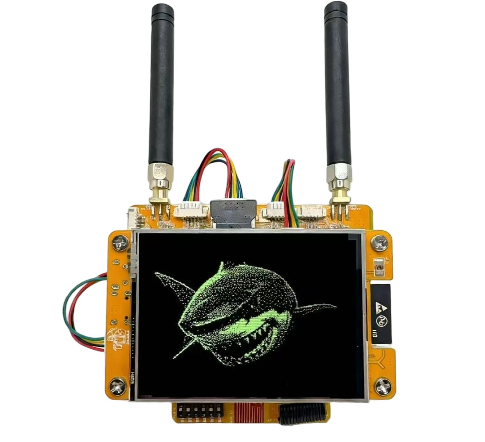

> [English](./README.md) | **简体中文**

# :shark: Bruce 固件

**Bruce** 是一款功能丰富的 ESP32 便携式红队/进攻性安全测试固件，旨在让安全评估和硬件实验更加快速、便携。

支持 [M5Stack](https://shop.m5stack.com)、[LILYGO](https://lilygo.cc)、[RockBase IoT](https://www.rockbaseiot.com) 及 [Elecrow](https://www.elecrow.com) 等多款设备，包括 Cardputer、M5Stick、M5Core、**LilyGO T-Deck / T-Deck Plus**、T-Embed 等。

---

## :zap: 官方开发板：RF REAPER

**RF REAPER** 是专为 Bruce 打造的开源定制 PCB 开发板，开箱即用支持 Sub-GHz、NFC/RFID、IR、2.4GHz（NRF）、GPS 接口与 microSD 卡，搭载 ESP32-S3（16MB Flash / 8MB PSRAM）及 AW9523 GPIO 扩展芯片，兼容 Flipper Zero 与 iButton 接口。

- 购买官方开发板：https://shop.bruce.computer
- 开源硬件资料：https://bruce.computer/boards

---

## :building_construction: 安装与刷写指南

### 方式一：使用 Makefile 一键自动编译并刷写（推荐，支持 LilyGO T-Deck）

本仓库内置了 [Makefile](./Makefile)，会自动检测兼容的 PlatformIO 环境（优先使用 `~/.platformio/penv/bin/pio`，避免 macOS Homebrew Python 3.15 与 ESP32 工具链不兼容的问题）以及串口设备（默认检测 `/dev/cu.usbmodem1101`，若端口变化会自动扫描可用 USB 串口）。

#### 1. 将 LilyGO T-Deck 进入下载模式（Bootloader）
1. 使用 **USB-C 数据线**将 T-Deck 连接到电脑。
2. 将电源开关拨至 **OFF（关闭）**。
3. **按住轨迹球按键不放**（对应 `GPIO0` / `BOOT`）。
4. 按住轨迹球的同时，将电源开关拨至 **ON（开启）**（若已开机，则短按侧面 **Reset** 键）。
5. 松开轨迹球。此时屏幕保持黑屏，说明已成功进入下载模式。

#### 2. 确认串口与一键刷写
```sh
# 检查串口（默认检测 /dev/cu.usbmodem1101）
make check-port

# 一键编译并刷写标准版 LilyGO T-Deck（默认 ENV=lilygo-t-deck, PORT=/dev/cu.usbmodem1101）
make install
```

#### 3. 常用 Makefile 命令
```sh
# 快捷刷写不同机型
make tdeck                                              # 标准版 LilyGO T-Deck (lilygo-t-deck)
make tdeck-plus                                         # LilyGO T-Deck Plus (lilygo-t-deck-pro)
make cardputer                                          # M5Stack Cardputer (m5stack-cardputer)

# 手动指定板卡环境与串口
make install ENV=lilygo-t-deck PORT=/dev/cu.usbmodem1101

# 仅编译（生成合并后的 Bruce-<ENV>.bin）
make build ENV=lilygo-t-deck

# 跳过重新编译，直接重新上传（适用于上次因未进下载模式而上传失败）
make upload ENV=lilygo-t-deck

# 使用 esptool 直接烧录合并后的 .bin 文件（ESP32-S3 偏移地址 0x00000）
make flash-bin ENV=lilygo-t-deck

# 打开串口监视器（115200 波特率）
make monitor

# 列出所有检测到的 USB 串口 / 支持的所有板卡环境 / 清理构建缓存
make ports
make envs
make clean
```

> **提示**：烧录完成后，请按一下设备侧面的 **Reset** 键（或重新开关电源）即可启动进入 Bruce。如需使用附带的脚本/字典/资源文件，可将 [sd_files](./sd_files) 目录中的内容复制到 FAT32 格式的 microSD 卡中。

---

### 方式二：使用官方 Web Flasher 在线刷写（最简单，无需本地编译）

使用 Chrome 或 Edge 浏览器打开官方网页刷写工具：

- **https://bruce.computer/flasher**

选择对应的设备型号（例如 **LilyGO T-Deck** 或 **LilyGO T-Deck Plus**），将设备进入下载模式后点击连接串口即可一键刷写。

---

### 方式三：使用 `esptool` 本地刷写预编译 `.bin`

从 Releases 或 GitHub Actions 下载对应设备的合并二进制文件 `Bruce-<device>.bin` 后，通过 `esptool` 刷写：

```sh
# macOS 示例（ESP32-S3 如 LilyGO T-Deck）
esptool --chip esp32s3 --port /dev/cu.usbmodem1101 --baud 921600 write_flash 0x00000 Bruce-lilygo-t-deck.bin

# Linux 示例
esptool.py --port /dev/ttyACM0 write_flash 0x00000 Bruce-<device>.bin
```

---

### 方式四：M5Stack 设备专用

- 如已安装 **M5Launcher**，可直接使用 OTA 在线安装。
- 也可通过 [M5Burner](https://docs.m5stack.com/en/download) 搜索 `Bruce`（官方版本上传者为 `owner` 且带有配图）选择对应机型直接烧录。

---

## :keyboard: 社区与文档

- **Discord 社区**：https://discord.gg/WJ9XF9czVT
- **官方 Wiki**：https://wiki.bruce.computer/
- **常见问题 FAQ**：https://wiki.bruce.computer/faq/

---

## :computer: 功能清单

<details>
  <summary><h3>WiFi</h3></summary>

- [x] 连接 WiFi / 开启 WiFi AP / 断开连接
- [x] WiFi 攻击模块（Beacon 广播泛洪、目标信息侦察、Target Deauth、EvilPortal + Deauth、多目标 Deauth 泛洪）
- [x] Wardriving（配合 GPS 记录与 Wigle 上传）
- [x] TelNet / SSH 客户端
- [x] RAW 抓包嗅探器（RAW Sniffer）
- [x] TCP 客户端 / TCP 监听器
- [x] Evil Portal（钓鱼门户）
- [x] 局域网主机与 TCP 端口扫描（Scan Hosts）
- [x] Responder / ARP 欺骗与投毒
- [x] WireGuard 隧道
- [x] Brucegotchi（Pwnagotchi 交互与 Pwngrid 广播）
</details>

<details>
  <summary><h3>BLE（低功耗蓝牙）</h3></summary>

- [x] BLE 扫描
- [x] Bad BLE（运行类似 BadUSB 的 Ducky 脚本）
- [x] BLE 蓝牙键盘（仅限 Cardputer 与 T-Deck）
- [x] iOS / Windows / Samsung / Android / 全平台广播弹窗泛洪（Spam）
</details>

<details>
  <summary><h3>RF（射频 / Sub-GHz）</h3></summary>

- [x] 扫描 / 复制与重放（Replay）
- [x] 自定义 Sub-GHz（兼容 Flipper 负载格式）
- [x] 频谱分析（Spectrum）
- [x] 全波 / 间歇式干扰（Jammer）
- [x] 支持 RF433 T/R 模块与 CC1101（可自定义 TX/RX 引脚与频率）
</details>

<details>
  <summary><h3>RFID / NFC</h3></summary>

- [x] 读卡 / 125kHz 低频读取 / 克隆卡片
- [x] 读写 NDEF 记录 / 读写与擦除数据 / 保存与加载卡片文件
- [x] Amiibolink / Chameleon 支持
- [x] 支持 PN532、PN532Killer 及 ST25R3916 等模块
</details>

<details>
  <summary><h3>IR（红外）</h3></summary>

- [x] TV-B-Gone
- [x] 红外接收与自定义发射（支持 NEC、NECext、SIRC、SIRC15、SIRC20、Samsung32、RC5、RC5X、RC6 等协议，兼容 Flipper 格式）
- [x] 可配置 IR TX / RX 引脚
</details>

<details>
  <summary><h3>FM（调频广播）</h3></summary>

- [x] 标准频段 / 保留频段发射与停止广播
</details>

<details>
  <summary><h3>NRF24（2.4GHz）</h3></summary>

- [x] NRF24 干扰器（Jammer）
- [x] 2.4G 频谱扫描
</details>

<details>
  <summary><h3>脚本与其它工具</h3></summary>

- [x] JavaScript 解释器（支持自定义 JS 脚本）
- [x] 麦克风频谱（Mic Spectrum）
- [x] 二维码生成（自定义 / PIX）
- [x] SD 卡与 LittleFS 文件管理器（查看图片/文件、播放音频、Wigle 上传）
- [x] WebUI 网页控制台（远程管理设备、SD 卡与文件系统）
- [x] BadUSB（支持 LittleFS 与 SD 卡）与 USB 键盘（仅限 Cardputer 与 T-Deck）
- [x] iButton / LED 控制 / Megalodon
</details>

<details>
  <summary><h3>Wire Tools（硬件总线调试工具）</h3></summary>

- [x] UART 串口终端（预设与自定义波特率 300..5000000，支持自定义 RX/TX 引脚）
- [x] I2C 总线（0x08–0x77 设备扫描、寄存器读写与 256 字节转储）
- [x] SPI 总线（JEDEC Flash 检测、CS 分帧 HEX 控制台）
- [x] JTAG 扫描器（IDCODE 读取）
- [x] 万用表通断测试（引脚间与对地通断检测 + 蜂鸣提示）
- [x] 支持通过串口 CLI 执行 `wire uart|i2c|spi|jtag|cont ...`
</details>

<details>
  <summary><h3>时钟、互联与系统设置</h3></summary>

- [x] RTC 时钟、NTP 网络校时与手动校时
- [x] Connect（ESP-NOW）：设备间文件收发与指令收发
- [x] 系统配置：亮度、息屏时间、屏幕方向、UI 主题色、开机音效、休眠与重启
</details>

---

## :gear: 设备功能支持对照表

> 未在表中单独列出的基础功能默认为所有设备通用支持。

| 设备 | CC1101 | NRF24 | FM 收音/广播 | PN532 / NFC | 麦克风 | BadUSB | RGB LED | 扬声器 | 电量计 | LITE_VERSION |
| --- | :---: | :---: | :---: | :---: | :---: | :---: | :---: | :---: | :---: | :---: |
| [M5Stack Cardputer](https://shop.m5stack.com/products/m5stack-cardputer-kit-w-m5stamps) (含 ADV) | :ok: | :ok: | :ok: | :ok: | :ok: | :ok: | :ok: | NS4168 | :x: | :x: |
| [M5Stack M5StickC PLUS2](https://shop.m5stack.com/products/m5stickc-plus2-esp32-mini-iot-development-kit) | :ok: | :ok: | :ok: | :ok: | :ok: | :ok:¹ | :x: | Tone | :x: | :x: |
| [M5Stack M5StickC PLUS](https://shop.m5stack.com/products/m5stickc-plus-esp32-pico-mini-iot-development-kit) | :ok: | :ok: | :ok: | :ok: | :ok: | :ok:¹ | :x: | Tone | :x: | :x:² |
| [M5Stack M5Core BASIC](https://shop.m5stack.com/products/basic-core-iot-development-kit) | :ok: | :ok: | :ok: | :ok: | :ok: | :ok:¹ | :x: | Tone | :x: | :x: |
| [M5Stack M5Core2](https://shop.m5stack.com/products/m5stack-core2-esp32-iot-development-kit-v1-1) | :ok: | :ok: | :ok: | :ok: | :ok: | :ok:¹ | :x: | :x: | :x: | :x: |
| [M5Stack M5CoreS3](https://shop.m5stack.com/products/m5stack-cores3-esp32s3-lotdevelopment-kit) / SE | :ok: | :ok: | :ok: | :ok: | :x: | :ok: | :x: | :x: | :x: | :x: |
| [M5Stack StackChan](https://shop.m5stack.com/products/stackchan-kawaii-co-created-open-source-ai-desktop-robot) | :ok: | :ok: | :ok: | ST25R3916 (I2C) | :x: | :ok: | :x: | AW88298 | :x: | :x: |
| [JCZN CYD-2432S028](https://www.aliexpress.us/item/3256804774970998.html) | :ok: | :ok: | :ok: | :ok: | :x: | :ok:¹ | :x: | :x: | :x: | :x:² |
| [Lilygo T-Embed CC1101](https://lilygo.cc/products/t-embed-cc1101) | :ok: | :ok: | :ok: | :ok: | :ok: | :ok: | :ok: | :ok: | :ok: | :x: |
| [Lilygo T-Embed](https://lilygo.cc/products/t-embed) | :ok: | :ok: | :ok: | :ok: | :ok: | :ok: | :ok: | :ok: | :x: | :x: |
| [Lilygo T-Display-S3](https://lilygo.cc/products/t-display-s3) | :ok: | :ok: | :x: | :x: | :x: | :ok: | :x: | :x: | :x: | :x: |
| **[Lilygo T-Deck](https://lilygo.cc/products/t-deck) ([及 T-Deck Plus](https://lilygo.cc/products/t-deck-plus-1))** | :ok: | :x: | :x: | :x: | :x: | :ok: | :x: | :x: | :x: | :x: |
| [Lilygo T-Watch-S3](https://lilygo.cc/products/t-watch-s3) | :x: | :x: | :x: | :x: | :x: | :ok: | :x: | :x: | :x: | :x: |
| [Lilygo T-LoRa Pager](https://lilygo.cc/products/t-lora-pager) | :x: | :x: | :x: | :x: | :x: | :ok: | :x: | :x: | :x: | :x: |
| [Smoochiee V2](https://www.pcbway.com/project/shareproject/Bruce_PCB_Smoochiee_d6a0284b.html) | :ok: | :ok: | :x: | :ok: | :x: | :ok: | :ok: | :x: | :x: | :x: |
| [ESP32-C5](https://docs.espressif.com/projects/esp-dev-kits/en/latest/esp32c5/esp32-c5-devkitc-1/user_guide.html) | :ok: | :ok: | :x: | :x: | :x: | :x: | :x: | :x: | :x: | :x: |
| [Bruce RF Reaper](https://www.elecrow.com/bruce-pcb-rf-reaper.html) | :ok: | :ok: | :x: | ST25R3916 | :x: | :ok: | :ok: | :x: | :ok: | :x: |
| [Elecrow 24B](https://www.elecrow.com/2-4inch-esp32-miner-lcd-display-2pcs-cryptocurrency-solo-miner-with-1000kh-s-hashrate.html) | :ok: | :ok: | :ok: | :ok: | :x: | :ok:¹ | :x: | :x: | :x: | :x:² |
| [Elecrow 3.5"](https://www.elecrow.com/esp-terminal-with-esp32-3-5-inch-parallel-480x320-tft-capacitive-touch-display-rgb-by-chip-ili9488.html) | :ok: | :ok: | :ok: | :ok: | :x: | :ok:¹ | :x: | :x: | :x: | :x:² |
| [NM-CYD-C5 + RF HAT](https://rockbase.shop/products/nm-cyd-c5-colorful) | :ok: | :ok: | :x: | :ok: | :x: | :ok: | :ok: | :x: | :ok: | :x: |
| [Waveshare ESP32-C5-Touch-LCD-3.5](https://github.com/waveshareteam/ESP32-C5-Touch-LCD-3.5) | :x: | :x: | :x: | :ok: | :ok: | :x: | :x: | :ok: | :x: | :x: |

- ¹ Core、CYD 与 StickC 的 BadUSB 用法请参阅：[BadUSB 文档](https://wiki.bruce.computer/features/others/#badusb)
- ² 为兼容 M5Launcher，部分 4MB Flash 设备提供 `LITE_VERSION` 精简版（不包含 TelNet、SSH、WireGuard、ScanHosts、RawSniffer、Brucegotchi、BLEBeacon、BLEScan 与 JS 解释器）。

---

## :sparkles: 界面预览




更多图片与演示媒体请查看 [./media/](./media/)。

---

## :clap: 致谢与第三方开源许可

感谢所有为 Bruce 固件、硬件设计与功能移植做出贡献的开发者（完整名单见 [README.md](./README.md)），以及以下给予本项目启发的开源项目：

- [ESP32Marauder](https://github.com/justcallmekoko/ESP32Marauder)
- [Launcher](https://github.com/bmorcelli/Launcher)
- [Evil-M5Project](https://github.com/7h30th3r0n3/Evil-M5Project)
- [M5Stick-Nemo](https://github.com/n0xa/m5stick-nemo)

第三方依赖库及开源合规说明请参见 [THIRD_PARTY.md](./THIRD_PARTY.md)。

---

## :construction: 免责声明

Bruce 是一款面向网络安全研究与授权红队演练的工具，遵循 **GNU Affero General Public License (AGPL)** 开源协议发布。本软件**仅限用于合法且已获得明确授权的安全测试与学习研究**，严禁将其用于任何非法或未经授权的恶意用途。下载、安装或使用 Bruce 即表示您同意遵守所在国家及地区的法律法规。本软件免费提供，开发者不对任何滥用行为或由此产生的后果承担责任，使用风险由使用者自行承担。
